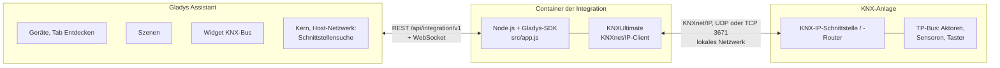
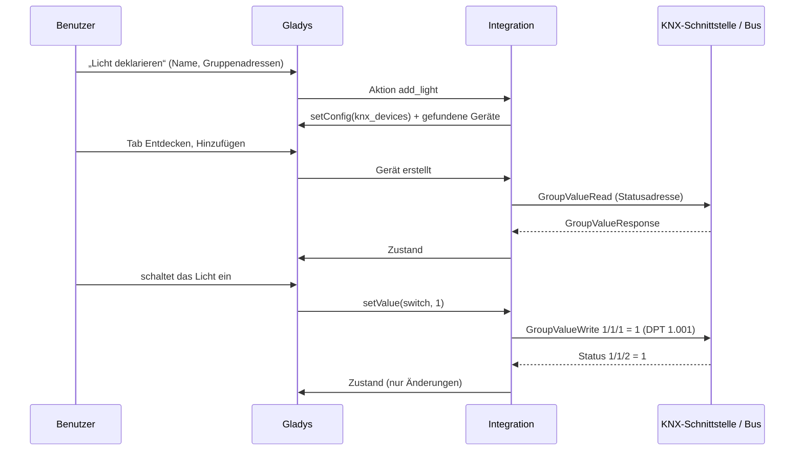
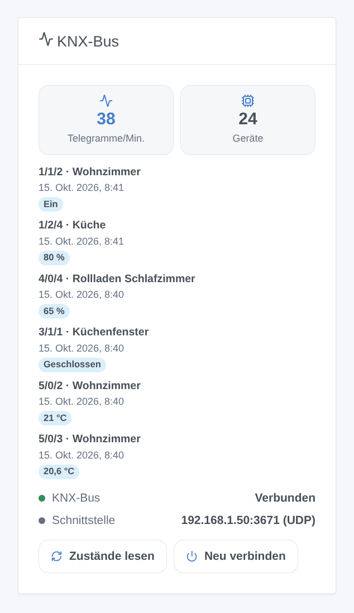

# KNX für Gladys Assistant

[English](README.md) | [Français](README.fr.md) | **Deutsch** | [Español](README.es.md)

[](LICENSE)
[](https://github.com/William-De71/gladys-knx/releases)
[](https://github.com/William-De71/gladys-knx/actions/workflows/release.yml)
[](https://gladysassistant.com)


Ihre KNX-Anlage in Gladys Assistant, über eine KNX-IP-Schnittstelle oder einen KNX-IP-Router in Ihrem lokalen Netzwerk: Licht, Schalter, Rollläden, Sensoren und Thermostate im Dashboard und in den Szenen. Sie deklarieren jedes Gerät einmal mit den Gruppenadressen Ihres ETS-Projekts, und seine Zustände folgen dem Bus in Echtzeit.

## Funktionen

- **Verbindung**: UDP-Tunneling, TCP-Tunneling, **KNX-IP-Secure**-Tunneling (Tunnelbenutzer und Passwort) und Routing, mit automatischer Wiederverbindung. Die KNX-IP-Schnittstellen im Netzwerk werden automatisch gefunden, wenn die Adresse leer bleibt.
- **Geräte**, in der Konfiguration mit ihren Gruppenadressen deklariert und dann im Tab Entdecken hinzugefügt: Licht (Ein/Aus, Helligkeit, RGB-Farbe, Farbtemperatur), Schalter, Rollläden und Vorhänge (Auf/Ab, Stopp, Position), Sensoren (Temperatur, Luftfeuchtigkeit, Helligkeit, CO2, Luftdruck, Windgeschwindigkeit, Leistung, Energiezähler, Spannung, Strom, Prozentsatz, Zähler), Binärsensoren (Bewegung, Anwesenheit, Fensterkontakt, Rauch, Leck, Regen), Thermostate (Sollwert, gemessene Temperatur).
- **Zustände in Echtzeit** vom Bus, beim Start und im gewählten Intervall gelesen, innerhalb der Ratenbegrenzung von Gladys veröffentlicht.
- **Dashboard-Widget** „KNX-Bus“: Verbindung, Telegramme pro Minute, letzte Telegramme, Schaltflächen Zustände lesen und Neu verbinden.
- **Szenenauslöser**: ein KNX-Telegramm wird empfangen (Taster, Zentralfunktionen, Alarme), die Verbindung ist unterbrochen, die Verbindung ist wiederhergestellt.
- **Szenenaktionen**: einen Wert an eine beliebige Gruppenadresse senden, einen Wert lesen, eine KNX-Szene abrufen.
- Texte auf Englisch, Französisch, Deutsch und Spanisch.

## Funktionsweise




Die deklarierten Geräte werden in der Gladys-Konfiguration gespeichert (also auch in den Gladys-Backups). Jedes Telegramm vom Bus wird mit dem Datenpunkttyp seiner Gruppenadresse dekodiert und wird zu einem Gladys-Zustand; jeder Gladys-Befehl wird zu einem GroupValueWrite.




### Geräte und Funktionen

| Art         | Gruppenadressen (DPT)                                                                                                                                               | Gladys-Funktionen                                                                                                                          |
| ----------- | ------------------------------------------------------------------------------------------------------------------------------------------------------------------- | ------------------------------------------------------------------------------------------------------------------------------------------ |
| Licht       | Schalten (1.001) + Status, Helligkeit (5.001) + Status, RGB-Farbe (232.600) + Status, Farbtemperatur (7.600) + Status                                               | `light/binary`, `light/brightness`, `light/color`, `light/temperature`                                                                     |
| Schalter    | Schalten (1.001) + Status                                                                                                                                           | `switch/binary`                                                                                                                            |
| Rollladen   | Auf/Ab (1.008), Stopp (1.007 / 1.010), Position (5.001) + Status                                                                                                    | `shutter` oder `curtain`: `state`, `position`                                                                                              |
| Sensor      | Wert: 9.001, 9.007, 9.004, 9.008, 9.006, 9.005, 14.056 / 9.024, 13.013, 13.010, 14.027 / 9.020, 14.019 / 7.012, 5.001, 12.001 (und 4-Byte-Gleitkommazahlen, DPT 14) | Temperatur, Luftfeuchtigkeit, Helligkeit, CO2, Druck, Geschwindigkeit, Energie (Leistung, Zählerstand, Spannung, Strom), Füllstand, Zähler |
| Binärsensor | Zustand (1.x)                                                                                                                                                       | Bewegung, Anwesenheit, Öffnung, Rauch, Leck, Regen, allgemein                                                                              |
| Thermostat  | Sollwert (9.001) + Status, gemessene Temperatur                                                                                                                     | `thermostat/target-temperature`, `temperature-sensor`                                                                                      |

## Transport

Nur lokal (`transports: ["local"]`, Badge **lokal** in Gladys): Die Integration spricht per KNXnet/IP mit der KNX-IP-Schnittstelle in Ihrem Netzwerk, nichts geht ins Internet. Klassisches KNX ist im Netzwerk weder verschlüsselt noch authentifiziert: Nutzen Sie KNX-IP-Secure-Tunneling, wenn Ihre Schnittstelle es unterstützt.

## Widget



Das Widget **KNX-Bus** zeigt die Verbindung, die Telegramme der letzten Minute, die deklarierten Geräte und die letzten Telegramme mit Gerätenamen und Wert; **Zustände lesen** fragt alle Statusadressen ab, **Neu verbinden** öffnet eine neue Verbindung. Einstellungen: Anzahl der Telegramme, Filter für Gruppenadressen (`1/*, 2/1/*`).

## Szenenauslöser und -aktionen

| Art      | Schlüssel             | Verwendung                                                                                                                                                                            |
| -------- | --------------------- | ------------------------------------------------------------------------------------------------------------------------------------------------------------------------------------- |
| Auslöser | `telegram_received`   | ein Telegramm an einer Adresse aus „Gruppenadressen für Szenen“: Filter Gruppenadresse, Telegrammtyp, Wert; Variablen Gruppenadresse, Absender, Typ, Wert, numerischer Wert, Rohdaten |
| Auslöser | `connection_lost`     | die Verbindung zur Schnittstelle ist abgebrochen (Schnittstelle, Grund)                                                                                                               |
| Auslöser | `connection_restored` | die Verbindung funktioniert wieder (Schnittstelle, Ausfalldauer in Sekunden)                                                                                                          |
| Aktion   | `send_value`          | einen Wert (on, 21.5, #ff8000…) mit einem DPT an eine beliebige Gruppenadresse schreiben                                                                                              |
| Aktion   | `read_value`          | eine Gruppenadresse lesen; Ausgaben Wert, numerischer Wert, Rohdaten                                                                                                                  |
| Aktion   | `recall_scene`        | eine KNX-Szenennummer von 1 bis 64 senden (DPT 17.001)                                                                                                                                |

Beispiele:

- Wenn der Taster „Alles aus“ im Eingang (0/0/1) aus sendet → die Lichter ausschalten, die nicht KNX sind, und benachrichtigen.
- Wenn die Alarmanlage scharf geschaltet wird → die KNX-Szene 3 „Abwesend“ abrufen und die Rollläden schließen.
- Wenn die KNX-Verbindung unterbrochen ist → dem Haushalt eine Nachricht senden.

## Voraussetzungen

- Gladys Assistant **5.3.0 oder neuer** (Katalog-Suchbegriffe von Gladys 5.3, Dashboard-Widgets sowie Szenenauslöser und -aktionen von Integrationen; ältere Instanzen können die Integration nicht installieren).
- Eine KNX-IP-Schnittstelle (Tunneling) oder ein KNX-IP-Router im selben Netzwerk wie Gladys, mit einem freien Tunnel.
- Die Gruppenadressen Ihres ETS-Projekts mit ihren Datenpunkttypen.

## Installation

- **Aus dem Store**: Integrationen → „KNX“ suchen → Installieren.
- **Über die URL des Repositorys**: Integrationen → Integration installieren → `https://github.com/William-De71/gladys-knx` einfügen.
- **Entwicklermodus**: Integrationen → Integration installieren → Entwicklermodus, mit dem Manifest eines Builds (die Zusammenfassung des Workflows „Build and publish image“ zeigt es an).

## Konfiguration

| Feld                           | Typ     | Standard     | Bedeutung                                                              |
| ------------------------------ | ------- | ------------ | ---------------------------------------------------------------------- |
| `connection_mode`              | select  | `tunnel_udp` | `tunnel_udp`, `tunnel_tcp` oder `routing`                              |
| `gateway_host`                 | string  |              | IP-Adresse oder Hostname der Schnittstelle; leer = die erste gefundene |
| `gateway_port`                 | number  | `3671`       | KNXnet/IP-Port                                                         |
| `individual_address`           | string  |              | physikalische Adresse von Gladys (beim Routing erforderlich)           |
| `secure`                       | boolean | `false`      | KNX IP Secure (TCP-Tunneling)                                          |
| `secure_tunnel_address`        | string  |              | physikalische Adresse des Tunnels, z. B. `1.1.254`                     |
| `secure_user_id`               | number  | `2`          | Benutzer-ID des Tunnels                                                |
| `secure_password`              | secret  |              | Passwort des Tunnelbenutzers                                           |
| `secure_device_authentication` | secret  |              | Geräte-Authentifizierungscode (optional)                               |
| `sync_states`                  | boolean | `true`       | Statusadressen beim Start lesen                                        |
| `sync_interval_minutes`        | number  | `60`         | alle N Minuten erneut lesen, `0` = nie                                 |
| `event_addresses`              | string  |              | Gruppenadressen für den Szenenauslöser: `1/0/*, 2/1/5:9.001`           |
| `language`                     | select  | `en`         | Sprache der Funktionsnamen                                             |

Schaltflächen der Konfigurationsseite: **Verbindung testen**, **KNX-IP-Schnittstellen suchen**, **Licht / Schalter / Rollladen / Sensor / Binärsensor / Thermostat deklarieren**, **Geräte auflisten**, **Deklariertes Gerät entfernen**.

## Verwendung

1. Verbindung ausfüllen, speichern, **Verbindung testen** drücken.
2. Ihre Geräte mit den Schaltflächen **… deklarieren** und ihren Gruppenadressen deklarieren (1/2/3, 1/515 oder 2563).
3. Sie im Tab **Entdecken** hinzufügen.
4. Das Widget **KNX-Bus** zu einem Dashboard hinzufügen, Ihre Szenen erstellen.

Die Benutzerdokumentation steht in [docs/de.md](docs/de.md) ([en](docs/en.md), [fr](docs/fr.md), [es](docs/es.md)).

## Lokale Entwicklung

```bash
npm install
GLADYS_HOST_API_URL=http://localhost:1443 \
  GLADYS_INTEGRATION_TOKEN=… GLADYS_INTEGRATION_SELECTOR=… \
  DEBUG=gladys-integration-sdk node index.js
```

| Variable                                                                         | Standard           | Verwendung                                                   |
| -------------------------------------------------------------------------------- | ------------------ | ------------------------------------------------------------ |
| `GLADYS_HOST_API_URL`, `GLADYS_INTEGRATION_TOKEN`, `GLADYS_INTEGRATION_SELECTOR` | von Gladys gesetzt | Verbindung zur Host-API von Gladys                           |
| `DEBUG`                                                                          | nicht gesetzt      | `gladys-integration-sdk` für die SDK-Protokolle              |
| `KNX_LOG_LEVEL`                                                                  | `disable`          | Protokolle von KNXUltimate: `error`, `warn`, `info`, `debug` |

Ohne KNX-Anlage stellt der `KNXIPTunnelServer` von KNXUltimate einen Tunneling-Server auf Ihrem Rechner bereit.

| Skript                            | Funktion                                 |
| --------------------------------- | ---------------------------------------- |
| `npm test`                        | die Tests (`node --test`), ohne Netzwerk |
| `npm run lint`                    | ESLint                                   |
| `npm run format` / `format:check` | Prettier                                 |
| `docs/illustrations/render.sh`    | die Widget-Illustrationen neu erzeugen   |
| `scripts/build-cover.sh`          | `cover.jpg` aus `cover.svg` neu erzeugen |

## Tests

`npm test` lässt die ganze Integration gegen das Fake-Gladys des SDK und einen Fake-Bus laufen (Deklaration, Entdecken, Telegramme zu Zuständen, Befehle zu Telegrammen mit ihrem DPT, Ratenbegrenzung, Szenen, Widget geprüft mit `validateWidgetContent`, Schnittstellensuche), die KNX-Schicht (Adressen, DPT, SEARCH-Datagramme, Wiederverbindung), jede Gerätevariante gegen die Funktionsregeln des Gladys-Kerns, das Manifest gegen den Code, die Übersetzungen und das Release-Skript. Die CI baut außerdem das Image und startet es wie Gladys (schreibgeschützt, 256 MB, ohne Netzwerk).

## Release-Prozess

Jeder Merge auf `main` veröffentlicht eine Version, wenn seine Commits es rechtfertigen, ohne manuellen Schritt:

```mermaid
flowchart LR
  A[Merge auf main] --> B[CI: Prettier, ESLint,<br/>Tests, Docker-Build]
  B --> C[nächste Version aus<br/>Conventional Commits]
  C --> D[Abschnitt in CHANGELOG.md]
  D --> E[Commit chore release<br/>+ Tag vX.Y.Z]
  E --> F[Image :X.Y.Z + :latest<br/>amd64 + arm64]
  F --> G[main rückt auf<br/>den Release-Commit]
  G --> H[GitHub Release]
  H --> I[Prüfung: anonymer Pull,<br/>Store-Validator, Topic]
```




- `feat` → Minor, `fix` / `perf` → Patch, `!` oder `BREAKING CHANGE:` → Major (unter 1.0.0 ein Minor). `docs`, `chore`, `ci`, `test`, `style`, `refactor`, `build` allein veröffentlichen nichts.
- Der Titel des Pull Requests wird zum Squash-Commit und damit zur Changelog-Zeile: auf Englisch, für den Benutzer schreiben (`feat(devices): …`). `pr-title.yml` prüft ihn. `CHANGELOG.md` nie von Hand bearbeiten.
- Das Image existiert, bevor `main` seine Version ankündigt (der Store indexiert `main`).
- 1.0.0 ist eine manuelle Entscheidung: Actions → Release → Run workflow, `release-as: 1.0.0`. `dry-run` zeigt Version und Changelog, ohne etwas zu veröffentlichen.
- **Geschütztes `main`**: Die Release pusht einen Commit auf `main`. Mit Branch-Schutz oder Ruleset GitHub Actions die Umgehung erlauben (oder eine GitHub App verwenden), sonst stoppt die Release nach dem Image.
- Nach der ersten Release das Paket öffentlich machen: Package settings → Change visibility → Public.

## Fehlerbehebung

- **Keine KNX-IP-Schnittstelle gefunden**: die IP-Adresse der Schnittstelle eingeben; manche Schnittstellen antworten nicht auf die Suche.
- **Die Verbindung bricht ab**: Eine Schnittstelle hat nur wenige Tunnel, geteilt mit ETS; den ETS-Busmonitor schließen oder Gladys einen eigenen Tunnel geben.
- **Ein Zustand kommt nie zurück**: das Lesen-Flag des Statusobjekts in ETS und die Statusadresse prüfen (das Widget zeigt, was ankommt).
- **Ein Rollladen fährt falsch herum**: **Position invertieren**, dann erneut deklarieren.
- Protokolle: Tab Protokolle der Integration; `DEBUG=gladys-integration-sdk` für die SDK-Details, `KNX_LOG_LEVEL=debug` für den KNX-Stack.

## Mitwirken

Issues und Pull Requests sind willkommen. `npm run format:check`, `npm run lint` und `npm test` ausführen, den Titel des Pull Requests als Conventional Commit schreiben und nach jeder Änderung am Widget-Inhalt `docs/illustrations/render.sh` ausführen. Eine neue Geräteart braucht ihre Datenpunkttypen und ein beschriftetes Gladys-Paar aus Kategorie und Typ (`test/devices.test.js`).

## Sicherheit

Siehe [SECURITY.md](SECURITY.md). Die Passwörter von KNX IP Secure sind `secret`-Felder: nie protokolliert, nie an den Browser zurückgeschickt.

## Lizenz

[Apache-Lizenz 2.0](LICENSE), siehe auch [NOTICE](NOTICE). Das Image enthält [KNXUltimate](https://github.com/Supergiovane/KNXUltimate) (MIT). KNX und das KNX-Logo sind Marken der KNX Association cvba; dieses Projekt ist weder mit der KNX Association verbunden noch von ihr unterstützt oder zertifiziert.
