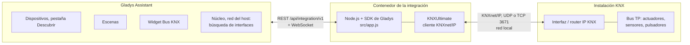
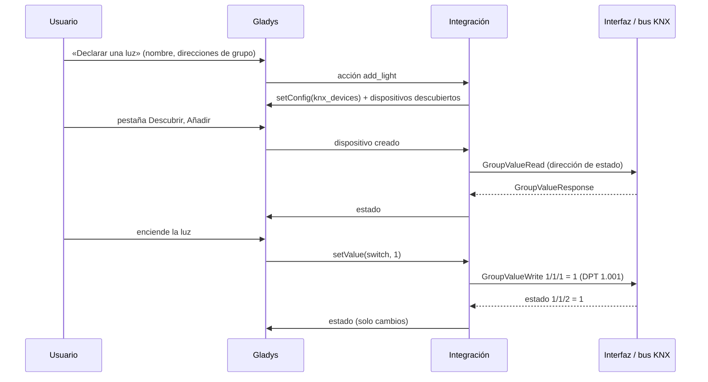
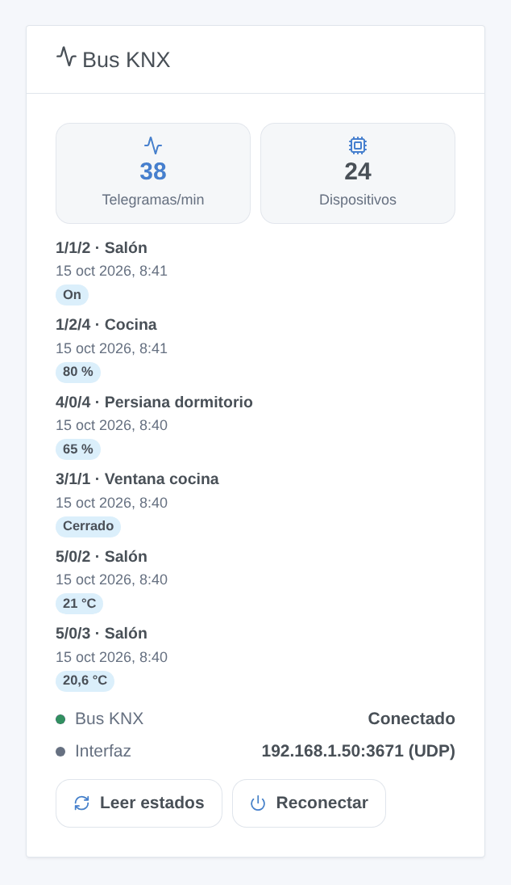

# KNX para Gladys Assistant

[English](README.md) | [Français](README.fr.md) | [Deutsch](README.de.md) | **Español**

[](LICENSE)
[](https://github.com/William-De71/gladys-knx/releases)
[](https://github.com/William-De71/gladys-knx/actions/workflows/release.yml)
[](https://gladysassistant.com)


Su instalación KNX en Gladys Assistant, a través de una interfaz o un router IP KNX de su red local: luces, interruptores, persianas, sensores y termostatos en el panel y en las escenas. Declara cada dispositivo una vez con las direcciones de grupo de su proyecto ETS, y sus estados siguen al bus en tiempo real.

## Funciones

- **Conexión**: tunneling UDP, tunneling TCP, tunneling **KNX IP Secure** (usuario y contraseña del túnel) y enrutamiento, con reconexión automática. Las interfaces IP KNX de la red se encuentran automáticamente si la dirección se deja vacía.
- **Dispositivos**, declarados desde la configuración con sus direcciones de grupo y añadidos después desde la pestaña Descubrir: luces (encendido/apagado, brillo, color RGB, temperatura de color), interruptores, persianas y cortinas (subir/bajar, parada, posición), sensores (temperatura, humedad, iluminancia, CO2, presión, velocidad del viento, potencia, contadores de energía, tensión, corriente, porcentaje, contador), sensores binarios (movimiento, presencia, contacto de ventana, humo, fuga, lluvia), termostatos (consigna, temperatura medida).
- **Estados en tiempo real** desde el bus, leídos al arrancar y en el intervalo elegido, publicados dentro del límite de Gladys.
- **Widget del panel** «Bus KNX»: conexión, telegramas por minuto, últimos telegramas, botones Leer estados y Reconectar.
- **Disparadores de escena**: se recibe un telegrama KNX (pulsadores, funciones centrales, alarmas), se pierde la conexión, se restablece la conexión.
- **Acciones de escena**: enviar un valor a cualquier dirección de grupo, leer un valor, recuperar una escena KNX.
- Textos en inglés, francés, alemán y español.

## Funcionamiento




Los dispositivos declarados se guardan en la configuración de Gladys (y por tanto en sus copias de seguridad). Cada telegrama del bus se decodifica con el tipo de punto de datos de su dirección de grupo y se convierte en un estado de Gladys; cada orden de Gladys se convierte en un GroupValueWrite.




### Dispositivos y funciones

| Clase          | Direcciones de grupo (DPT)                                                                                                                                                     | Funciones de Gladys                                                                                                         |
| -------------- | ------------------------------------------------------------------------------------------------------------------------------------------------------------------------------ | --------------------------------------------------------------------------------------------------------------------------- |
| Luz            | conmutación (1.001) + estado, brillo (5.001) + estado, color RGB (232.600) + estado, temperatura de color (7.600) + estado                                                     | `light/binary`, `light/brightness`, `light/color`, `light/temperature`                                                      |
| Interruptor    | conmutación (1.001) + estado                                                                                                                                                   | `switch/binary`                                                                                                             |
| Persiana       | subir/bajar (1.008), parada (1.007 / 1.010), posición (5.001) + estado                                                                                                         | `shutter` o `curtain`: `state`, `position`                                                                                  |
| Sensor         | valor: 9.001, 9.007, 9.004, 9.008, 9.006, 9.005, 14.056 / 9.024, 13.013, 13.010, 14.027 / 9.020, 14.019 / 7.012, 5.001, 12.001 (y números de coma flotante de 4 bytes, DPT 14) | temperatura, humedad, iluminancia, CO2, presión, velocidad, energía (potencia, índice, tensión, corriente), nivel, contador |
| Sensor binario | estado (1.x)                                                                                                                                                                   | movimiento, presencia, apertura, humo, fuga, lluvia, genérico                                                               |
| Termostato     | consigna (9.001) + estado, temperatura medida                                                                                                                                  | `thermostat/target-temperature`, `temperature-sensor`                                                                       |

## Transporte

Solo local (`transports: ["local"]`, insignia **local** en Gladys): la integración se comunica con la interfaz IP KNX de su red por KNXnet/IP, nada sale a Internet. El KNX clásico no está cifrado ni autenticado en la red: use el tunneling KNX IP Secure si su interfaz lo admite.

## Widget



El widget **Bus KNX** muestra la conexión, los telegramas del último minuto, los dispositivos declarados y los últimos telegramas con el nombre del dispositivo y el valor; **Leer estados** consulta todas las direcciones de estado, **Reconectar** abre una nueva conexión. Ajustes: número de telegramas, filtro de direcciones de grupo (`1/*, 2/1/*`).

## Disparadores y acciones de escena

| Clase      | Clave                 | Uso                                                                                                                                                                                                           |
| ---------- | --------------------- | ------------------------------------------------------------------------------------------------------------------------------------------------------------------------------------------------------------- |
| Disparador | `telegram_received`   | un telegrama en una dirección de «Direcciones de grupo para escenas»: filtros dirección de grupo, tipo de telegrama, valor; variables dirección de grupo, emisor, tipo, valor, valor numérico, datos en bruto |
| Disparador | `connection_lost`     | el enlace con la interfaz se ha caído (interfaz, motivo)                                                                                                                                                      |
| Disparador | `connection_restored` | el enlace vuelve a funcionar (interfaz, duración del corte en segundos)                                                                                                                                       |
| Acción     | `send_value`          | escribir un valor (on, 21.5, #ff8000…) con un DPT en cualquier dirección de grupo                                                                                                                             |
| Acción     | `read_value`          | leer una dirección de grupo; salidas valor, valor numérico, datos en bruto                                                                                                                                    |
| Acción     | `recall_scene`        | enviar un número de escena KNX de 1 a 64 (DPT 17.001)                                                                                                                                                         |

Ejemplos:

- Cuando el pulsador «Apagar todo» de la entrada (0/0/1) envía off → apagar las luces que no son KNX y notificar.
- Cuando se activa la alarma → recuperar la escena KNX 3 «Ausente» y cerrar las persianas.
- Cuando se pierde la conexión KNX → enviar un mensaje al hogar.

## Requisitos

- Gladys Assistant **5.3.0 o posterior** (palabras clave del catálogo de Gladys 5.3, widgets del panel y disparadores y acciones de escena de las integraciones; las instancias más antiguas no pueden instalar la integración).
- Una interfaz IP KNX (tunneling) o un router IP KNX en la misma red que Gladys, con un túnel libre.
- Las direcciones de grupo de su proyecto ETS, con sus tipos de punto de datos.

## Instalación

- **Desde la tienda**: Integraciones → buscar «KNX» → Instalar.
- **Desde la URL del repositorio**: Integraciones → Instalar una integración → pegar `https://github.com/William-De71/gladys-knx`.
- **Modo desarrollador**: Integraciones → Instalar una integración → Modo desarrollador, con el manifiesto de un build (el resumen del workflow «Build and publish image» lo muestra).

## Configuración

| Campo                          | Tipo    | Por defecto  | Significado                                                                 |
| ------------------------------ | ------- | ------------ | --------------------------------------------------------------------------- |
| `connection_mode`              | select  | `tunnel_udp` | `tunnel_udp`, `tunnel_tcp` o `routing`                                      |
| `gateway_host`                 | string  |              | dirección IP o nombre de host de la interfaz; vacío = la primera encontrada |
| `gateway_port`                 | number  | `3671`       | puerto KNXnet/IP                                                            |
| `individual_address`           | string  |              | dirección individual de Gladys (obligatoria con enrutamiento)               |
| `secure`                       | boolean | `false`      | KNX IP Secure (tunneling TCP)                                               |
| `secure_tunnel_address`        | string  |              | dirección individual del túnel, p. ej. `1.1.254`                            |
| `secure_user_id`               | number  | `2`          | ID de usuario del túnel                                                     |
| `secure_password`              | secret  |              | contraseña del usuario del túnel                                            |
| `secure_device_authentication` | secret  |              | código de autenticación del dispositivo (opcional)                          |
| `sync_states`                  | boolean | `true`       | leer las direcciones de estado al arrancar                                  |
| `sync_interval_minutes`        | number  | `60`         | volver a leerlas cada N minutos, `0` = nunca                                |
| `event_addresses`              | string  |              | direcciones de grupo del disparador de escena: `1/0/*, 2/1/5:9.001`         |
| `language`                     | select  | `en`         | idioma de los nombres de funciones                                          |

Botones de la página de configuración: **Probar la conexión**, **Buscar interfaces IP KNX**, **Declarar una luz / un interruptor / una persiana / un sensor / un sensor binario / un termostato**, **Listar los dispositivos**, **Quitar un dispositivo declarado**.

## Uso

1. Complete la conexión, guarde y pulse **Probar la conexión**.
2. Declare sus dispositivos con los botones **Declarar …** y sus direcciones de grupo (1/2/3, 1/515 o 2563).
3. Añádalos desde la pestaña **Descubrir**.
4. Añada el widget **Bus KNX** a un panel y cree sus escenas.

La documentación de usuario está en [docs/es.md](docs/es.md) ([en](docs/en.md), [fr](docs/fr.md), [de](docs/de.md)).

## Desarrollo local

```bash
npm install
GLADYS_HOST_API_URL=http://localhost:1443 \
  GLADYS_INTEGRATION_TOKEN=… GLADYS_INTEGRATION_SELECTOR=… \
  DEBUG=gladys-integration-sdk node index.js
```

| Variable                                                                         | Por defecto          | Uso                                                        |
| -------------------------------------------------------------------------------- | -------------------- | ---------------------------------------------------------- |
| `GLADYS_HOST_API_URL`, `GLADYS_INTEGRATION_TOKEN`, `GLADYS_INTEGRATION_SELECTOR` | definidas por Gladys | conexión con la API host de Gladys                         |
| `DEBUG`                                                                          | sin definir          | `gladys-integration-sdk` para los registros del SDK        |
| `KNX_LOG_LEVEL`                                                                  | `disable`            | registros de KNXUltimate: `error`, `warn`, `info`, `debug` |

Sin instalación KNX, el `KNXIPTunnelServer` de KNXUltimate ofrece un servidor de tunneling en su equipo.

| Script                            | Qué hace                                      |
| --------------------------------- | --------------------------------------------- |
| `npm test`                        | las pruebas (`node --test`), sin red          |
| `npm run lint`                    | ESLint                                        |
| `npm run format` / `format:check` | Prettier                                      |
| `docs/illustrations/render.sh`    | regenerar las ilustraciones del widget        |
| `scripts/build-cover.sh`          | regenerar `cover.jpg` a partir de `cover.svg` |

## Pruebas

`npm test` ejecuta toda la integración contra el Gladys simulado del SDK y un bus simulado (declaración, descubrimiento, telegramas a estados, órdenes a telegramas con su DPT, límite de publicación, escenas, widget validado con `validateWidgetContent`, búsqueda de interfaces), la capa KNX (direcciones, DPT, datagramas SEARCH, reconexión), cada variante de dispositivo contra las reglas de funciones del núcleo de Gladys, el manifiesto contra el código, las traducciones y el script de publicación. La CI también construye la imagen y la arranca como Gladys (solo lectura, 256 MB, sin red).

## Proceso de publicación

Cada merge en `main` publica una versión cuando sus commits lo justifican, sin ningún paso manual:

```mermaid
flowchart LR
  A[merge en main] --> B[CI: Prettier, ESLint,<br/>pruebas, build Docker]
  B --> C[siguiente versión desde<br/>los Conventional Commits]
  C --> D[sección de CHANGELOG.md]
  D --> E[commit chore release<br/>+ tag vX.Y.Z]
  E --> F[imagen :X.Y.Z + :latest<br/>amd64 + arm64]
  F --> G[main avanza al<br/>commit de publicación]
  G --> H[GitHub Release]
  H --> I[verificación: pull anónimo,<br/>validador de la tienda, topic]
```




- `feat` → menor, `fix` / `perf` → parche, `!` o `BREAKING CHANGE:` → mayor (una menor por debajo de 1.0.0). `docs`, `chore`, `ci`, `test`, `style`, `refactor`, `build` solos no publican nada.
- El título de la pull request se convierte en el commit squash y, por tanto, en la línea del changelog: escríbalo en inglés, para el usuario (`feat(devices): …`). `pr-title.yml` lo comprueba. Nunca edite `CHANGELOG.md` a mano.
- La imagen existe antes de que `main` anuncie su versión (la tienda indexa `main`).
- La 1.0.0 es una decisión manual: Actions → Release → Run workflow, `release-as: 1.0.0`. `dry-run` muestra la versión y el changelog sin publicar nada.
- **`main` protegida**: la publicación empuja un commit a `main`. Con una protección de rama o un ruleset, permita que GitHub Actions la omita (o use una GitHub App); si no, la publicación se detiene después de la imagen.
- Tras la primera publicación, haga público el paquete: Package settings → Change visibility → Public.

## Solución de problemas

- **No se encontró ninguna interfaz IP KNX**: introduzca la dirección IP de la interfaz; algunas interfaces no responden a la búsqueda.
- **La conexión se corta**: una interfaz solo tiene unos pocos túneles, compartidos con ETS; cierre el monitor de bus de ETS o reserve un túnel para Gladys.
- **Un estado nunca llega**: el indicador de lectura del objeto de estado en ETS y la dirección de estado (el widget muestra lo que llega).
- **Una persiana va en sentido contrario**: **Invertir la posición** y vuelva a declararla.
- Registros: pestaña Registros de la integración; `DEBUG=gladys-integration-sdk` para el detalle del SDK, `KNX_LOG_LEVEL=debug` para la pila KNX.

## Contribuir

Issues y pull requests son bienvenidas. Ejecute `npm run format:check`, `npm run lint` y `npm test`, escriba el título de la pull request como un Conventional Commit y ejecute `docs/illustrations/render.sh` tras cualquier cambio del contenido del widget. Una nueva clase de dispositivo necesita sus tipos de punto de datos y un par categoría/tipo de Gladys con etiqueta (`test/devices.test.js`).

## Seguridad

Consulte [SECURITY.md](SECURITY.md). Las contraseñas de KNX IP Secure son campos `secret`: nunca se registran ni se devuelven al navegador.

## Licencia

[Licencia Apache 2.0](LICENSE), véase también [NOTICE](NOTICE). La imagen incluye [KNXUltimate](https://github.com/Supergiovane/KNXUltimate) (MIT). KNX y el logotipo KNX son marcas de KNX Association cvba; este proyecto no está afiliado, respaldado ni certificado por KNX Association.
