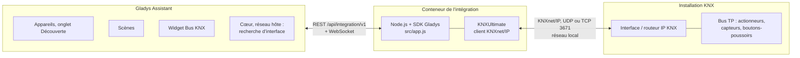
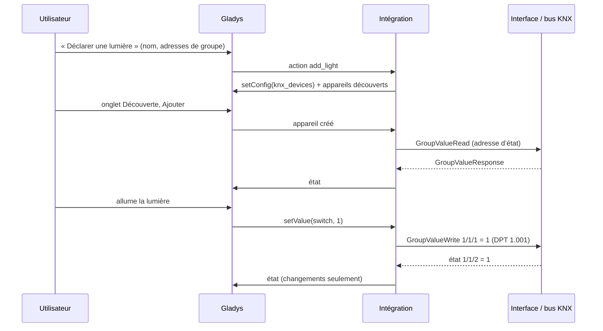
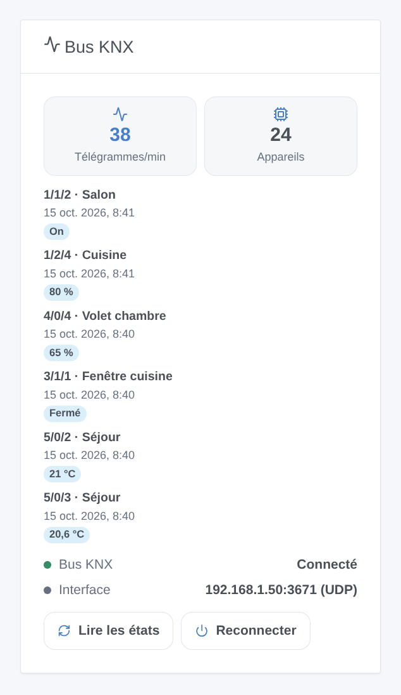

# KNX pour Gladys Assistant

[English](README.md) | **Français** | [Deutsch](README.de.md) | [Español](README.es.md)

[](LICENSE)
[](https://github.com/William-De71/gladys-knx/releases)
[](https://github.com/William-De71/gladys-knx/actions/workflows/release.yml)
[](https://gladysassistant.com)


Votre installation KNX dans Gladys Assistant, via une interface ou un routeur IP KNX de votre réseau local : lumières, interrupteurs, volets, capteurs et thermostats sur le tableau de bord et dans les scènes. Vous déclarez chaque appareil une fois avec les adresses de groupe de votre projet ETS, et ses états suivent le bus en temps réel.

## Fonctionnalités

- **Connexion** : tunneling UDP, tunneling TCP, tunneling **KNX IP Secure** (utilisateur et mot de passe du tunnel) et routage, avec reconnexion automatique. Les interfaces IP KNX du réseau sont trouvées automatiquement quand l’adresse est laissée vide.
- **Appareils**, déclarés depuis la configuration avec leurs adresses de groupe, puis ajoutés depuis l’onglet Découverte : lumières (marche/arrêt, luminosité, couleur RVB, température de couleur), interrupteurs, volets et rideaux (montée/descente, arrêt, position), capteurs (température, humidité, luminosité, CO2, pression, vitesse du vent, puissance, compteurs d’énergie, tension, courant, pourcentage, compteur), capteurs binaires (mouvement, présence, contact de fenêtre, fumée, fuite, pluie), thermostats (consigne, température mesurée).
- **États en temps réel** depuis le bus, lus au démarrage et à l’intervalle choisi, publiés dans la limite de débit de Gladys.
- **Widget de tableau de bord** « Bus KNX » : connexion, télégrammes par minute, derniers télégrammes, boutons Lire les états et Reconnecter.
- **Déclencheurs de scène** : un télégramme KNX est reçu (boutons-poussoirs, fonctions centrales, alarmes), la connexion est perdue, la connexion est rétablie.
- **Actions de scène** : envoyer une valeur sur n’importe quelle adresse de groupe, lire une valeur, rappeler une scène KNX.
- Textes en anglais, français, allemand et espagnol.

## Fonctionnement




Les appareils déclarés sont enregistrés dans la configuration de Gladys (donc dans ses sauvegardes). Chaque télégramme du bus est décodé avec le type de point de données de son adresse de groupe et devient un état Gladys ; chaque commande Gladys devient un GroupValueWrite.




### Appareils et fonctionnalités

| Genre           | Adresses de groupe (DPT)                                                                                                                                             | Fonctionnalités Gladys                                                                                                    |
| --------------- | -------------------------------------------------------------------------------------------------------------------------------------------------------------------- | ------------------------------------------------------------------------------------------------------------------------- |
| Lumière         | commutation (1.001) + état, luminosité (5.001) + état, couleur RVB (232.600) + état, température de couleur (7.600) + état                                           | `light/binary`, `light/brightness`, `light/color`, `light/temperature`                                                    |
| Interrupteur    | commutation (1.001) + état                                                                                                                                           | `switch/binary`                                                                                                           |
| Volet           | montée/descente (1.008), arrêt (1.007 / 1.010), position (5.001) + état                                                                                              | `shutter` ou `curtain` : `state`, `position`                                                                              |
| Capteur         | valeur : 9.001, 9.007, 9.004, 9.008, 9.006, 9.005, 14.056 / 9.024, 13.013, 13.010, 14.027 / 9.020, 14.019 / 7.012, 5.001, 12.001 (et flottants sur 4 octets, DPT 14) | température, humidité, luminosité, CO2, pression, vitesse, énergie (puissance, index, tension, courant), niveau, compteur |
| Capteur binaire | état (1.x)                                                                                                                                                           | mouvement, présence, ouverture, fumée, fuite, pluie, générique                                                            |
| Thermostat      | consigne (9.001) + état, température mesurée                                                                                                                         | `thermostat/target-temperature`, `temperature-sensor`                                                                     |

## Transport

Local uniquement (`transports: ["local"]`, badge **local** dans Gladys) : l’intégration dialogue avec l’interface IP KNX de votre réseau en KNXnet/IP, rien ne part sur Internet. Le KNX classique n’est ni chiffré ni authentifié sur le réseau : utilisez le tunneling KNX IP Secure si votre interface le permet.

## Widget



Le widget **Bus KNX** affiche la connexion, les télégrammes de la dernière minute, les appareils déclarés et les derniers télégrammes avec le nom de l’appareil et la valeur ; **Lire les états** interroge toutes les adresses d’état, **Reconnecter** ouvre une nouvelle connexion. Réglages : nombre de télégrammes, filtre d’adresses de groupe (`1/*, 2/1/*`).

## Déclencheurs et actions de scène

| Genre       | Clé                   | Usage                                                                                                                                                                                                                   |
| ----------- | --------------------- | ----------------------------------------------------------------------------------------------------------------------------------------------------------------------------------------------------------------------- |
| Déclencheur | `telegram_received`   | un télégramme sur une adresse de « Adresses de groupe pour les scènes » : filtres adresse de groupe, type de télégramme, valeur ; variables adresse de groupe, émetteur, type, valeur, valeur numérique, données brutes |
| Déclencheur | `connection_lost`     | la liaison avec l’interface est tombée (interface, raison)                                                                                                                                                              |
| Déclencheur | `connection_restored` | la liaison fonctionne de nouveau (interface, durée de la coupure en secondes)                                                                                                                                           |
| Action      | `send_value`          | écrire une valeur (on, 21.5, #ff8000…) avec un DPT sur n’importe quelle adresse de groupe                                                                                                                               |
| Action      | `read_value`          | lire une adresse de groupe ; sorties valeur, valeur numérique, données brutes                                                                                                                                           |
| Action      | `recall_scene`        | envoyer un numéro de scène KNX de 1 à 64 (DPT 17.001)                                                                                                                                                                   |

Exemples :

- Quand le bouton-poussoir « Tout éteindre » de l’entrée (0/0/1) envoie off → éteindre les lumières qui ne sont pas KNX et notifier.
- Quand l’alarme est activée → rappeler la scène KNX 3 « Absence » et fermer les volets.
- Quand la connexion KNX est perdue → envoyer un message au foyer.

## Prérequis

- Gladys Assistant **5.3.0 ou plus récent** (mots-clés du catalogue de Gladys 5.3, widgets de tableau de bord, déclencheurs et actions de scène des intégrations ; les instances plus anciennes ne peuvent pas installer l’intégration).
- Une interface IP KNX (tunneling) ou un routeur IP KNX sur le même réseau que Gladys, avec un tunnel libre.
- Les adresses de groupe de votre projet ETS, avec leurs types de points de données.

## Installation

- **Depuis le store** : Intégrations → chercher « KNX » → Installer.
- **Depuis l’URL du dépôt** : Intégrations → Installer une intégration → coller `https://github.com/William-De71/gladys-knx`.
- **Mode développeur** : Intégrations → Installer une intégration → Mode développeur, avec le manifeste d’un build (le résumé du workflow « Build and publish image » l’affiche).

## Configuration

| Champ                          | Type    | Défaut       | Rôle                                                                 |
| ------------------------------ | ------- | ------------ | -------------------------------------------------------------------- |
| `connection_mode`              | select  | `tunnel_udp` | `tunnel_udp`, `tunnel_tcp` ou `routing`                              |
| `gateway_host`                 | string  |              | adresse IP ou nom d’hôte de l’interface ; vide = la première trouvée |
| `gateway_port`                 | number  | `3671`       | port KNXnet/IP                                                       |
| `individual_address`           | string  |              | adresse physique de Gladys (obligatoire en routage)                  |
| `secure`                       | boolean | `false`      | KNX IP Secure (tunneling TCP)                                        |
| `secure_tunnel_address`        | string  |              | adresse physique du tunnel, par ex. `1.1.254`                        |
| `secure_user_id`               | number  | `2`          | ID de l’utilisateur du tunnel                                        |
| `secure_password`              | secret  |              | mot de passe de l’utilisateur du tunnel                              |
| `secure_device_authentication` | secret  |              | code d’authentification de l’appareil (facultatif)                   |
| `sync_states`                  | boolean | `true`       | lire les adresses d’état au démarrage                                |
| `sync_interval_minutes`        | number  | `60`         | les relire toutes les N minutes, `0` = jamais                        |
| `event_addresses`              | string  |              | adresses de groupe du déclencheur de scène : `1/0/*, 2/1/5:9.001`    |
| `language`                     | select  | `en`         | langue des noms de fonctionnalités                                   |

Boutons de la page de configuration : **Tester la connexion**, **Rechercher les interfaces IP KNX**, **Déclarer une lumière / un interrupteur / un volet / un capteur / un capteur binaire / un thermostat**, **Lister les appareils**, **Retirer un appareil déclaré**.

## Utilisation

1. Renseignez la connexion, enregistrez, appuyez sur **Tester la connexion**.
2. Déclarez vos appareils avec les boutons **Déclarer …** et leurs adresses de groupe (1/2/3, 1/515 ou 2563).
3. Ajoutez-les depuis l’onglet **Découverte**.
4. Ajoutez le widget **Bus KNX** à un tableau de bord, créez vos scènes.

La documentation utilisateur est dans [docs/fr.md](docs/fr.md) ([en](docs/en.md), [de](docs/de.md), [es](docs/es.md)).

## Développement local

```bash
npm install
GLADYS_HOST_API_URL=http://localhost:1443 \
  GLADYS_INTEGRATION_TOKEN=… GLADYS_INTEGRATION_SELECTOR=… \
  DEBUG=gladys-integration-sdk node index.js
```

| Variable                                                                         | Défaut              | Usage                                                      |
| -------------------------------------------------------------------------------- | ------------------- | ---------------------------------------------------------- |
| `GLADYS_HOST_API_URL`, `GLADYS_INTEGRATION_TOKEN`, `GLADYS_INTEGRATION_SELECTOR` | fournies par Gladys | connexion à l’API hôte de Gladys                           |
| `DEBUG`                                                                          | non définie         | `gladys-integration-sdk` pour les journaux du SDK          |
| `KNX_LOG_LEVEL`                                                                  | `disable`           | journaux de KNXUltimate : `error`, `warn`, `info`, `debug` |

Sans installation KNX, le `KNXIPTunnelServer` de KNXUltimate fournit un serveur de tunneling sur votre machine.

| Script                            | Rôle                                     |
| --------------------------------- | ---------------------------------------- |
| `npm test`                        | les tests (`node --test`), sans réseau   |
| `npm run lint`                    | ESLint                                   |
| `npm run format` / `format:check` | Prettier                                 |
| `docs/illustrations/render.sh`    | régénérer les illustrations du widget    |
| `scripts/build-cover.sh`          | régénérer `cover.jpg` depuis `cover.svg` |

## Tests

`npm test` fait tourner toute l’intégration contre le faux Gladys du SDK et un faux bus (déclaration, découverte, télégrammes vers états, commandes vers télégrammes avec leur DPT, limite de débit, scènes, widget validé par `validateWidgetContent`, recherche d’interface), la couche KNX (adresses, DPT, datagrammes SEARCH, reconnexion), chaque variante d’appareil contre les règles de fonctionnalités du cœur de Gladys, le manifeste contre le code, les traductions et le script de release. La CI construit aussi l’image et la démarre comme Gladys (lecture seule, 256 Mo, sans réseau).

## Processus de release

Chaque merge sur `main` publie une version quand ses commits le justifient, sans action manuelle :

```mermaid
flowchart LR
  A[merge sur main] --> B[CI : Prettier, ESLint,<br/>tests, build Docker]
  B --> C[version suivante depuis<br/>les Conventional Commits]
  C --> D[section du CHANGELOG.md]
  D --> E[commit chore release<br/>+ tag vX.Y.Z]
  E --> F[image :X.Y.Z + :latest<br/>amd64 + arm64]
  F --> G[main avance sur<br/>le commit de release]
  G --> H[GitHub Release]
  H --> I[vérification : pull anonyme,<br/>validateur du store, topic]
```




- `feat` → mineure, `fix` / `perf` → correctif, `!` ou `BREAKING CHANGE:` → majeure (une mineure sous 1.0.0). `docs`, `chore`, `ci`, `test`, `style`, `refactor`, `build` seuls ne publient rien.
- Le titre de la pull request devient le commit squash, donc la ligne du changelog : écrivez-le en anglais, pour l’utilisateur (`feat(devices): …`). `pr-title.yml` le vérifie. Ne modifiez jamais `CHANGELOG.md` à la main.
- L’image existe avant que `main` annonce sa version (le store indexe `main`).
- La 1.0.0 est une décision manuelle : Actions → Release → Run workflow, `release-as: 1.0.0`. `dry-run` affiche la version et le changelog sans rien publier.
- **`main` protégée** : la release pousse un commit sur `main`. Avec une protection de branche ou un ruleset, autorisez GitHub Actions à la contourner (ou utilisez une GitHub App), sinon la release s’arrête après l’image.
- Après la première release, rendez le package public : Package settings → Change visibility → Public.

## Dépannage

- **Aucune interface IP KNX trouvée** : saisissez l’adresse IP de l’interface ; certaines interfaces ne répondent pas à la recherche.
- **La connexion tombe** : une interface n’a que quelques tunnels, partagés avec ETS ; fermez le moniteur de bus d’ETS ou réservez un tunnel à Gladys.
- **Un état ne remonte jamais** : l’indicateur de lecture de l’objet d’état dans ETS, et l’adresse d’état (le widget montre ce qui arrive).
- **Un volet va dans le mauvais sens** : **Inverser la position**, puis déclarez-le de nouveau.
- Journaux : onglet Journaux de l’intégration ; `DEBUG=gladys-integration-sdk` pour le détail du SDK, `KNX_LOG_LEVEL=debug` pour la pile KNX.

## Contribuer

Issues et pull requests bienvenues. Lancez `npm run format:check`, `npm run lint` et `npm test`, écrivez le titre de la pull request en Conventional Commit et relancez `docs/illustrations/render.sh` après tout changement du contenu du widget. Un nouveau genre d’appareil demande ses types de points de données et un couple catégorie/type Gladys libellé (`test/devices.test.js`).

## Sécurité

Voir [SECURITY.md](SECURITY.md). Les mots de passe KNX IP Secure sont des champs `secret` : jamais journalisés, jamais renvoyés au navigateur.

## Licence

[Licence Apache 2.0](LICENSE), voir aussi [NOTICE](NOTICE). L’image embarque [KNXUltimate](https://github.com/Supergiovane/KNXUltimate) (MIT). KNX et le logo KNX sont des marques de KNX Association cvba ; ce projet n’est ni affilié, ni approuvé, ni certifié par KNX Association.
