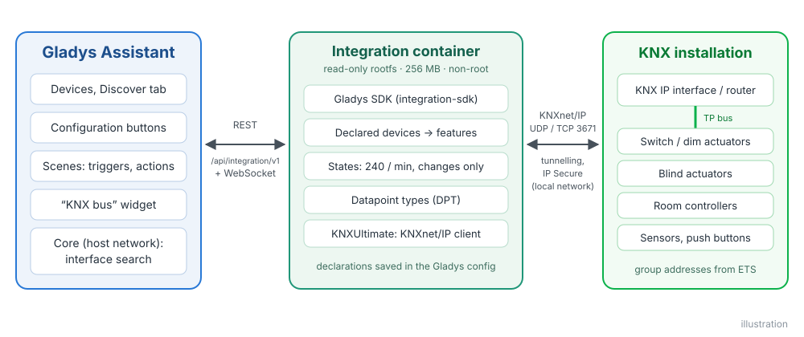
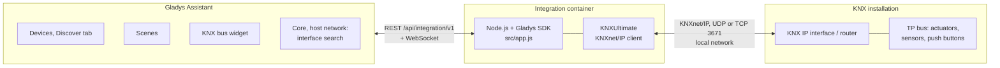
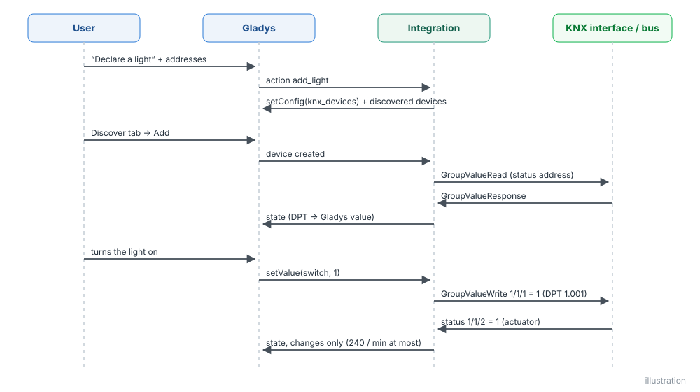
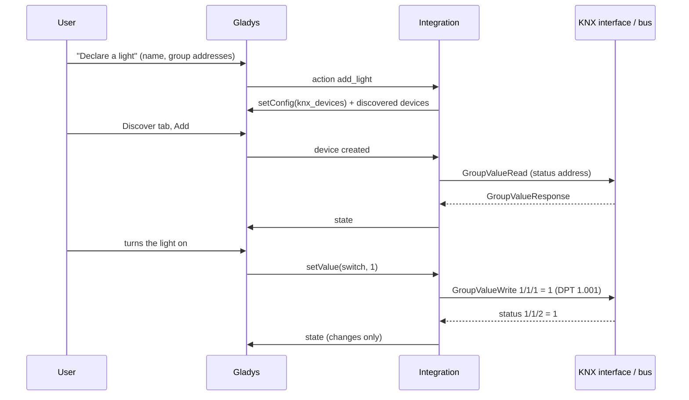
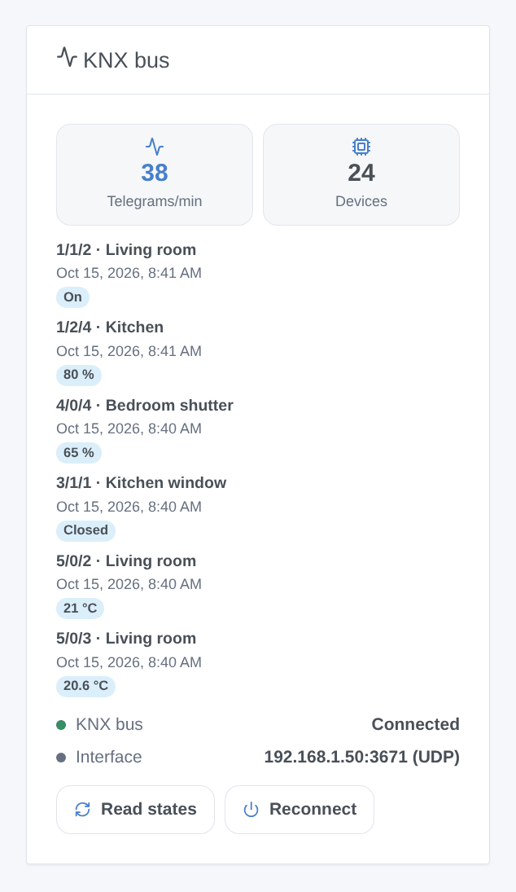
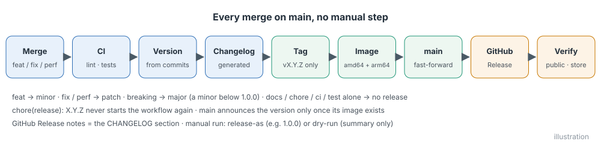

# KNX for Gladys Assistant

**English** | [Français](README.fr.md) | [Deutsch](README.de.md) | [Español](README.es.md)

[](LICENSE)
[](https://github.com/William-De71/gladys-knx/releases)
[](https://github.com/William-De71/gladys-knx/actions/workflows/release.yml)
[](https://gladysassistant.com)


Your KNX installation in Gladys Assistant, through a KNX IP interface or router on your local network: lights, switches, covers, sensors and thermostats on the dashboard and in the scenes. You declare each device once with the group addresses of your ETS project, and its states follow the bus in real time.

## Features

- **Connection**: UDP tunnelling, TCP tunnelling, **KNX IP Secure** tunnelling (tunnel user and password) and routing, with automatic reconnection. The KNX IP interfaces of the network are found automatically when the address is left empty.
- **Devices**, declared from the configuration with their group addresses, then added from the Discover tab: lights (on/off, brightness, RGB color, color temperature), switches, shutters and curtains (up/down, stop, position), sensors (temperature, humidity, illuminance, CO2, pressure, wind speed, power, energy meters, voltage, current, percentage, counter), binary sensors (motion, presence, window contact, smoke, leak, rain), thermostats (setpoint, measured temperature).
- **States in real time** from the bus, read at startup and at a chosen interval, published within the Gladys rate limit.
- **Dashboard widget** "KNX bus": connection, telegrams per minute, last telegrams, Read states and Reconnect buttons.
- **Scene triggers**: a KNX telegram is received (push buttons, central functions, alarms), the connection is lost, the connection is restored.
- **Scene actions**: send a value on any group address, read a value, recall a KNX scene.
- Texts in English, French, German and Spanish.

## How it works





The declared devices are saved in the Gladys configuration (so in the Gladys backups). Each telegram of the bus is decoded with the datapoint type of its group address and becomes a Gladys state; each Gladys command becomes a GroupValueWrite.





### Devices and features

| Kind          | Group addresses (DPT)                                                                                                                                      | Gladys features                                                                                             |
| ------------- | ---------------------------------------------------------------------------------------------------------------------------------------------------------- | ----------------------------------------------------------------------------------------------------------- |
| Light         | switch (1.001) + status, brightness (5.001) + status, RGB color (232.600) + status, color temperature (7.600) + status                                     | `light/binary`, `light/brightness`, `light/color`, `light/temperature`                                      |
| Switch        | switch (1.001) + status                                                                                                                                    | `switch/binary`                                                                                             |
| Cover         | up/down (1.008), stop (1.007 / 1.010), position (5.001) + status                                                                                           | `shutter` or `curtain`: `state`, `position`                                                                 |
| Sensor        | value: 9.001, 9.007, 9.004, 9.008, 9.006, 9.005, 14.056 / 9.024, 13.013, 13.010, 14.027 / 9.020, 14.019 / 7.012, 5.001, 12.001 (and 4-byte floats, DPT 14) | temperature, humidity, light, CO2, pressure, speed, energy (power, index, voltage, current), level, counter |
| Binary sensor | state (1.x)                                                                                                                                                | motion, presence, opening, smoke, leak, rain, generic                                                       |
| Thermostat    | setpoint (9.001) + status, measured temperature                                                                                                            | `thermostat/target-temperature`, `temperature-sensor`                                                       |

## Transport

Local only (`transports: ["local"]`, **local** badge in Gladys): the integration talks to the KNX IP interface on your network over KNXnet/IP, nothing goes to the internet. Plain KNX is neither encrypted nor authenticated on the network: use KNX IP Secure tunnelling when your interface supports it.

## Widget



The **KNX bus** widget shows the connection, the telegrams of the last minute, the declared devices and the last telegrams with the device name and the value; **Read states** asks every status address, **Reconnect** opens a new connection. Settings: number of telegrams, group address filter (`1/*, 2/1/*`).

## Scene triggers and actions

| Kind    | Key                   | Use                                                                                                                                                                          |
| ------- | --------------------- | ---------------------------------------------------------------------------------------------------------------------------------------------------------------------------- |
| Trigger | `telegram_received`   | a telegram on an address of “Group addresses for scenes”: filters group address, telegram type, value; variables group address, sender, type, value, numeric value, raw data |
| Trigger | `connection_lost`     | the link to the interface dropped (interface, reason)                                                                                                                        |
| Trigger | `connection_restored` | the link works again (interface, downtime in seconds)                                                                                                                        |
| Action  | `send_value`          | write a value (on, 21.5, #ff8000…) with a DPT to any group address                                                                                                           |
| Action  | `read_value`          | read a group address; outputs value, numeric value, raw data                                                                                                                 |
| Action  | `recall_scene`        | send a KNX scene number 1-64 (DPT 17.001)                                                                                                                                    |

Examples:

- When the "All off" push button of the entrance (0/0/1) sends off → turn off the lights that are not KNX and notify.
- When the alarm is armed → recall the KNX scene 3 "Away" and close the covers.
- When the KNX connection is lost → send a message to the household.

## Requirements

- Gladys Assistant **5.3.0 or later** (catalog keywords of Gladys 5.3, dashboard widgets and scene triggers and actions of integrations; older instances cannot install the integration).
- A KNX IP interface (tunnelling) or KNX IP router on the same network as Gladys, with a free tunnel.
- The group addresses of your ETS project, with their datapoint types.

## Installation

- **From the store**: Integrations → search "KNX" → Install.
- **From the repository URL**: Integrations → Install an integration → paste `https://github.com/William-De71/gladys-knx`.
- **Developer mode**: Integrations → Install an integration → Developer mode, with the manifest of a build (the summary of the "Build and publish image" workflow prints it).

## Configuration

| Field                          | Type    | Default      | Meaning                                                               |
| ------------------------------ | ------- | ------------ | --------------------------------------------------------------------- |
| `connection_mode`              | select  | `tunnel_udp` | `tunnel_udp`, `tunnel_tcp` or `routing`                               |
| `gateway_host`                 | string  |              | IP address or host name of the interface; empty = the first one found |
| `gateway_port`                 | number  | `3671`       | KNXnet/IP port                                                        |
| `individual_address`           | string  |              | individual address of Gladys (required for routing)                   |
| `secure`                       | boolean | `false`      | KNX IP Secure (TCP tunnelling)                                        |
| `secure_tunnel_address`        | string  |              | individual address of the tunnel, e.g. `1.1.254`                      |
| `secure_user_id`               | number  | `2`          | tunnel user ID                                                        |
| `secure_password`              | secret  |              | tunnel user password                                                  |
| `secure_device_authentication` | secret  |              | device authentication code (optional)                                 |
| `sync_states`                  | boolean | `true`       | read the status addresses at startup                                  |
| `sync_interval_minutes`        | number  | `60`         | read them again every N minutes, `0` = never                          |
| `event_addresses`              | string  |              | group addresses for the scene trigger: `1/0/*, 2/1/5:9.001`           |
| `language`                     | select  | `en`         | language of the feature names                                         |

Buttons of the configuration page: **Test the connection**, **Search for KNX IP interfaces**, **Declare a light / switch / cover / sensor / binary sensor / thermostat**, **List the devices**, **Remove a declared device**.

## Usage

1. Fill in the connection, save, press **Test the connection**.
2. Declare your devices with the **Declare a …** buttons and their group addresses (1/2/3, 1/515 or 2563).
3. Add them from the **Discover** tab.
4. Add the **KNX bus** widget to a dashboard, create your scenes.

The user documentation is in [docs/en.md](docs/en.md) ([fr](docs/fr.md), [de](docs/de.md), [es](docs/es.md)).

## Local development

```bash
npm install
GLADYS_HOST_API_URL=http://localhost:1443 \
  GLADYS_INTEGRATION_TOKEN=… GLADYS_INTEGRATION_SELECTOR=… \
  DEBUG=gladys-integration-sdk node index.js
```

| Variable                                                                         | Default       | Use                                                   |
| -------------------------------------------------------------------------------- | ------------- | ----------------------------------------------------- |
| `GLADYS_HOST_API_URL`, `GLADYS_INTEGRATION_TOKEN`, `GLADYS_INTEGRATION_SELECTOR` | set by Gladys | connection to the Gladys host API                     |
| `DEBUG`                                                                          | unset         | `gladys-integration-sdk` for the SDK logs             |
| `KNX_LOG_LEVEL`                                                                  | `disable`     | logs of KNXUltimate: `error`, `warn`, `info`, `debug` |

Without a KNX installation, the `KNXIPTunnelServer` of KNXUltimate is a tunnelling server on your machine to connect to.

| Script                            | What it does                            |
| --------------------------------- | --------------------------------------- |
| `npm test`                        | the tests (`node --test`), no network   |
| `npm run lint`                    | ESLint                                  |
| `npm run format` / `format:check` | Prettier                                |
| `docs/illustrations/render.sh`    | regenerate the widget illustrations     |
| `scripts/build-cover.sh`          | regenerate `cover.jpg` from `cover.svg` |

## Tests

`npm test` runs the whole integration against the fake Gladys of the SDK and a fake bus (declaration, discovery, telegrams to states, commands to telegrams with their DPT, rate limit, scenes, widget validated by `validateWidgetContent`, interface search), the KNX layer (addresses, DPT, SEARCH datagrams, reconnection), every device variant against the feature rules of the Gladys core, the manifest against the code, the translations and the release script. The CI also builds the image and starts it like Gladys does (read-only, 256 MB, no network).

## Release process

Every merge on `main` publishes a release when its commits deserve one, with no manual step:

```mermaid
flowchart LR
  A[merge on main] --> B[CI: Prettier, ESLint,<br/>tests, Docker build]
  B --> C[next version from<br/>Conventional Commits]
  C --> D[CHANGELOG.md section]
  D --> E[commit chore release<br/>+ tag vX.Y.Z]
  E --> F[image :X.Y.Z + :latest<br/>amd64 + arm64]
  F --> G[main moves to<br/>the release commit]
  G --> H[GitHub Release]
  H --> I[verify: anonymous pull,<br/>store validator, topic]
```





- `feat` → minor, `fix` / `perf` → patch, `!` or `BREAKING CHANGE:` → major (a minor below 1.0.0). `docs`, `chore`, `ci`, `test`, `style`, `refactor`, `build` alone publish nothing.
- The pull request title becomes the squash commit, hence the changelog line: write it in English, for the user (`feat(devices): …`). `pr-title.yml` checks it. Never edit `CHANGELOG.md` by hand.
- The image exists before `main` announces its version (the store indexes `main`).
- 1.0.0 is a manual decision: Actions → Release → Run workflow, `release-as: 1.0.0`. `dry-run` shows the version and the changelog without publishing.
- **Protected `main`**: the release pushes a commit to `main`. With a branch protection or a ruleset, allow GitHub Actions to bypass it (or use a GitHub App), otherwise the release stops after the image.
- After the first release, make the package public: Package settings → Change visibility → Public.

## Troubleshooting

- **No KNX IP interface found**: enter the IP address of the interface; some interfaces do not answer the search.
- **The connection drops**: an interface has a few tunnels only, shared with ETS; close the ETS bus monitor or give Gladys its own tunnel.
- **A state never comes back**: the read flag of the status object in ETS, and the status address (the widget shows what arrives).
- **A cover goes the wrong way**: **Invert the position**, then declare it again.
- Logs: the Logs tab of the integration; `DEBUG=gladys-integration-sdk` for the SDK details, `KNX_LOG_LEVEL=debug` for the KNX stack.

## Contributing

Issues and pull requests are welcome. Run `npm run format:check`, `npm run lint` and `npm test`, write the pull request title as a Conventional Commit, and run `docs/illustrations/render.sh` after any change to the widget content. A new device kind needs its datapoint types and a labeled Gladys category/type pair (`test/devices.test.js`).

## Security

See [SECURITY.md](SECURITY.md). The passwords of KNX IP Secure are `secret` fields: never logged, never sent back to the browser.

## License

[Apache License 2.0](LICENSE), see also [NOTICE](NOTICE). The image bundles [KNXUltimate](https://github.com/Supergiovane/KNXUltimate) (MIT). KNX and the KNX logo are trademarks of KNX Association cvba; this project is not affiliated with, endorsed or certified by KNX Association.
